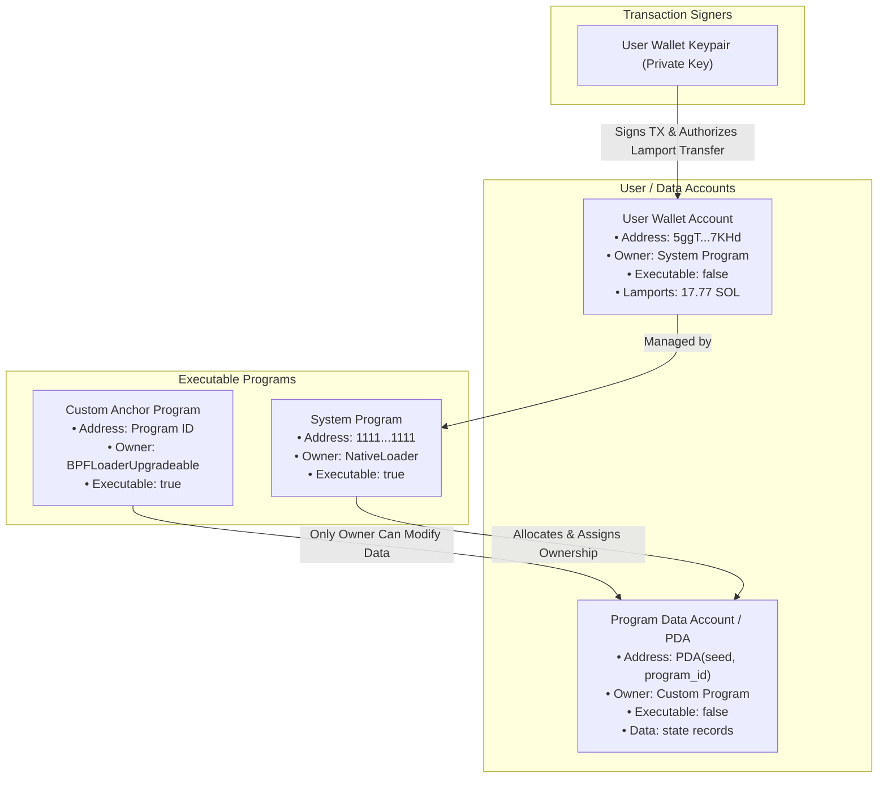

# Solana Account Watchlist CLI (Week 1)

A command-line tool built in Rust for inspecting, classifying, and comparing Solana accounts on **devnet** using JSON-RPC.

---

## Features

- **Batch Reading (`getMultipleAccounts`)**: Queries multiple Solana accounts in a single RPC round-trip.
- **Strict Pre-Request Validation**: Validates base58 character set and length (32–44 chars) before issuing network requests.
- **Safe Balance Formatting**: Integer-only arithmetic converts lamports to SOL without floating-point precision loss.
- **Privacy & Secret Protection**: Detects the cluster and sanitizes the RPC endpoint URL to prevent leaking API keys, auth tokens, or query parameters.
- **Fault-Tolerant Reporting**: Malformed addresses or individual errors report actionable diagnostics without interrupting or hiding results for other accounts.
- **Account Classification & Comparison**: Distinguishes executable program accounts (bytecode owned by `NativeLoader` or `BPFLoader`) from state/wallet accounts (owned by the System Program or custom programs) and unallocated addresses.

---

## Usage

### Run Tests
```bash
cargo test
```

### Inspect Accounts
Accepts two or more public addresses:
```bash
cargo run -- <ADDRESS_1> <ADDRESS_2> [ADDITIONAL_ADDRESSES...]
```

To specify an alternative devnet RPC endpoint:
```bash
SOLANA_DEVNET_RPC_URL="https://api.devnet.solana.com" cargo run -- <ADDRESS_1> <ADDRESS_2>
```

---

## Sample Command & Output

### 1. Inspecting Wallet and Program Accounts
```bash
cargo run -- 5ggTuwYT92FqEdBJqDKPMgq6QfAp7ihsvUpgFmq47KHd 11111111111111111111111111111111
```

```text
Cluster: devnet
Address: 5ggTuwYT92FqEdBJqDKPMgq6QfAp7ihsvUpgFmq47KHd
Explorer: https://explorer.solana.com/address/5ggTuwYT92FqEdBJqDKPMgq6QfAp7ihsvUpgFmq47KHd?cluster=devnet
Balance: 17773281124 lamports (17.773281124 SOL)
Owner program: 11111111111111111111111111111111
Executable: no

Cluster: devnet
Address: 11111111111111111111111111111111
Explorer: https://explorer.solana.com/address/11111111111111111111111111111111?cluster=devnet
Balance: 1 lamports (0.000000001 SOL)
Owner program: NativeLoader1111111111111111111111111111111
Executable: yes

Account Comparison Summary:
- Executable programs: 1
  • 11111111111111111111111111111111 (Owner: NativeLoader1111111111111111111111111111111, executable)
- Data accounts: 1
  • 5ggTuwYT92FqEdBJqDKPMgq6QfAp7ihsvUpgFmq47KHd (Balance: 17.773281124 SOL, Owner: 11111111111111111111111111111111)
```

### 2. Handling Bad and Unallocated Addresses Gracefully
```bash
cargo run -- not-an-address 5ggTuwYT92FqEdBJqDKPMgq6QfAp7ihsvUpgFmq47KHd 6wE29RaZgANhAr24QKntqQf2jmrvbH9WzmQ8hwdLHmas 11111111111111111111111111111111
```

```text
Cluster: devnet
Address: 5ggTuwYT92FqEdBJqDKPMgq6QfAp7ihsvUpgFmq47KHd
Explorer: https://explorer.solana.com/address/5ggTuwYT92FqEdBJqDKPMgq6QfAp7ihsvUpgFmq47KHd?cluster=devnet
Balance: 17773281124 lamports (17.773281124 SOL)
Owner program: 11111111111111111111111111111111
Executable: no

Cluster: devnet
Address: 6wE29RaZgANhAr24QKntqQf2jmrvbH9WzmQ8hwdLHmas
Explorer: https://explorer.solana.com/address/6wE29RaZgANhAr24QKntqQf2jmrvbH9WzmQ8hwdLHmas?cluster=devnet
Account: no onchain data found yet

Cluster: devnet
Address: 11111111111111111111111111111111
Explorer: https://explorer.solana.com/address/11111111111111111111111111111111?cluster=devnet
Balance: 1 lamports (0.000000001 SOL)
Owner program: NativeLoader1111111111111111111111111111111
Executable: yes

Cluster: devnet
Address: not-an-address
Explorer: https://explorer.solana.com/address/not-an-address?cluster=devnet
Account: invalid address (Invalid address: enter a Solana public address (base58, 32–44 characters).)

Account Comparison Summary:
- Executable programs: 1
  • 11111111111111111111111111111111 (Owner: NativeLoader1111111111111111111111111111111, executable)
- Data accounts: 1
  • 5ggTuwYT92FqEdBJqDKPMgq6QfAp7ihsvUpgFmq47KHd (Balance: 17.773281124 SOL, Owner: 11111111111111111111111111111111)
- Unallocated / No data: 1
  • 6wE29RaZgANhAr24QKntqQf2jmrvbH9WzmQ8hwdLHmas
- Invalid addresses: 1
  • not-an-address: Invalid address: enter a Solana public address (base58, 32–44 characters).
```

---

## Onchain Insights

1. **Separation of Code and Data**: On Solana, executable programs (such as the System Program `1111...1111`) are stateless bytecode accounts owned by a loader (`NativeLoader` or `BPFLoader`). They do not store user state directly.
2. **Account Ownership**: Standard user wallets (like `5ggTuwYT...7KHd`) are data accounts owned by the System Program. Only the owning program can write to an account's data or deduct lamports (subject to transaction signatures).
3. **Unallocated Addresses**: Any valid ed25519 public key or PDA is an address, but it does not exist in the validator ledger (`value: null`) until funded with rent-exempt lamports.

---

## Project Move: Account Model

The diagram below illustrates Solana's account model: who owns each account, who may update data or transfer lamports, and who must sign.



| Account | What Data Exists | Who Owns It | Who May Update It | Who Must Sign |
| :--- | :--- | :--- | :--- | :--- |
| **User Wallet Account** | Lamport balance, system metadata | System Program (`1111...1111`) | System Program | Wallet Private Key |
| **Executable Program** | Compiled SBF bytecode | `NativeLoader` or `BPFLoader` | Upgrade Authority (if upgradeable) | Upgrade Authority keypair |
| **PDA / Application State** | Domain state (e.g. kudos, profiles) | Custom Application Program | Owning Custom Program | User signer (for mutations) or Program PDA seeds |
